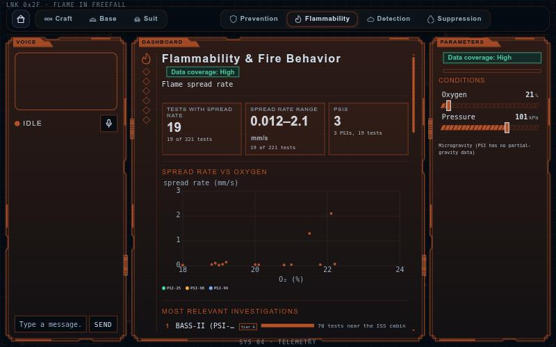
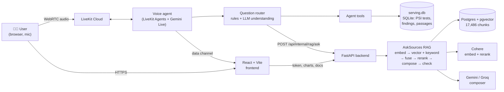

<div align="center">

# 🔥 Flamo: AstroEntropy

### A voice fire-safety copilot for spacecraft, habitats and spacesuits

**NASA Space Apps Challenge 2026 · _Flame in Freefall_**

Ask out loud how fire behaves in microgravity. Flamo answers in seconds with numbers taken only from NASA's Physical Sciences Informatics (PSI) combustion experiments and the papers behind them, and it shows you where every number came from.


<!--  -->


</div>

---

## ✨ Why Flamo?

On Earth, hot air rises and carries a flame upward. In microgravity there's no buoyancy, so flames spread, smoke and go out differently, and intuition built on Earth is often wrong. NASA has flown many combustion experiments on the ISS and in drop towers, but the results are spread across thousands of test records, reports and papers.

**Flamo turns that archive into a crew member you can talk to.** An astronaut, mission planner or student can ask:

> *"Does fire spread faster in space?"*
> *"What happens to flames in the spacesuit atmosphere?"*
> *"How did the E-FIELD Flames experiment mimic partial gravity?"*
> *"Compare BASS and BASS-II."*

Flamo answers by voice and builds a live dashboard at the same time: charts, the closest tested conditions, and numbered sources linked to the NASA documents.

## 🧭 Core principles

| | Principle |
|---|---|
| 🎯 | **Every number has a source.** Numbers come only from a database result or a cited passage, and a checker drops any generated sentence whose numbers don't appear in the cited text. |
| 🚫 | **Never "safe", never "safest".** The PSI data doesn't define safe or dangerous oxygen levels, so Flamo reports where tests burned rather than declaring a limit. |
| 🕳️ | **Gaps are reported as gaps.** If the data doesn't cover a question, Flamo says so and names what's missing, instead of guessing. |
| ⚡ | **Built for voice.** The answer pipeline has a hard time budget, with fallbacks at every step, so the spoken answer arrives in about 2–4 seconds. |


## 🚀 Features

- **🎙️ Real-time voice agent:** speech in and out through LiveKit and Gemini Live, with noise cancellation. You can interrupt it, and it handles follow-ups and clarifying questions ("Which do you mean: SPICE or BASS-II?").
- **🧠 Hybrid question router:** fast rules classify the question; a small LLM step resolves unclear ones. In parallel, the router dispatches to the right tools: structured database queries, document retrieval (RAG), or both.
- **📚 Scoped RAG over NASA documents:** 17,486 chunks of PSI reports and papers in Postgres + pgvector. It uses Cohere `embed-v4.0` embeddings, an HNSW vector index plus full-text search, rank fusion, and Cohere rerank. Answers are composed by Gemini, with Groq as a backup.
- **✅ Number checker:** a pure-code verifier. Any sentence whose number isn't in the cited source text is dropped and replaced by an extractive sentence taken directly from the source.
- **🗄️ `serving.db`, the curated experiment database:** 24 PSI investigations, 2,409 tests, 332 findings and 8,406 text passages, queried by 20+ agent tools: compare investigations, rank materials, the oxygen effect, scenario coverage, research gaps, and more.
- **📊 Live mission dashboard:** four pillars (*Prevention, Flammability, Detection, Suppression*) across three scenarios (*Craft, Base, Suit*), plus an adjustable O₂ and pressure panel that updates while you talk.
- **🚨 Fire-emergency mode:** saying "fire", "smoke" or "burning" in an emergency context switches the agent to an alert flow.
- **🌍 3D landing scene:** Earth, Moon and Mars rendered with Three.js.

## 🏗️ Architecture



**How a question is answered**

1. The agent transcribes the question, and the **router** classifies its intent and entities (investigation, material, O₂, pressure, scenario).
2. Database tools and the **RAG** branch run **in parallel** under a 4.5 s budget.
3. RAG: scope by investigation → embed → HNSW vector search + full-text search → reciprocal-rank fusion → Cohere rerank → LLM composer → **number checker**.
4. If any step fails or times out, the answer falls back to an extractive sentence or to full-text search on `serving.db`, so the user always hears something within the window.
5. The answer is **spoken** and the **dashboard** gets the matching card, chart and sources.

## 📁 Repository layout

```
backend-api/           Python: FastAPI app, voice agent, router, RAG (paper_rag/), tools, tests, scripts
  ├─ src/agent.py        LiveKit voice agent entry point
  ├─ src/api.py          FastAPI: token, charts, docs, internal RAG endpoint
  ├─ src/router/         question understanding + answer planning
  ├─ src/paper_rag/      retrieval, rerank, composer, number checker, pgvector store
  └─ tests/              pytest suite
frontend/              React 18 + Vite web app (LiveKit components, Three.js, dashboard)
voice-agent-livekit/   Dockerfile + config to deploy the agent on LiveKit Cloud
data/serving.db        the curated PSI experiment database (SQLite)
data/postgres/         Postgres + pgvector image definition (the RAG dump is not included)
deploy/                Caddy (HTTPS for the API) and a self-hosted all-in-one stack
docker-compose.yml     Postgres (RAG index) + backend API
docs/                  deploy guide, design notes, front-end/back-end contract, screenshots
```

## 🛠️ Getting started

### Prerequisites
- Python **3.12** with [uv](https://github.com/astral-sh/uv)
- Node.js **18+**
- A [LiveKit Cloud](https://livekit.io) project (or a local `livekit-server --dev`)
- API keys: **Google Gemini**, **Cohere**, and optionally **Groq**
- Docker, for the Postgres RAG index

### 1. Configure

This repository includes no environment files. Create `backend-api/.env.local` with your own values:

| Variable | Purpose |
|---|---|
| `LIVEKIT_URL`, `LIVEKIT_API_KEY`, `LIVEKIT_API_SECRET` | voice transport |
| `GOOGLE_API_KEY` | Gemini Live (the voice model) |
| `GEMINI_API_KEY_1`, `GEMINI_API_KEY_2`, … | composer key pool |
| `COHERE_API_KEY_1`, … | embeddings + rerank |
| `GROQ_API_KEY_1`, … *(optional)* | backup composer |
| `FLAMEO_DB` | path to `data/serving.db` |
| `POSTGRES_HOST`, `POSTGRES_PORT`, `POSTGRES_USER`, `POSTGRES_PASSWORD`, `POSTGRES_MAIN_DB` | RAG index |
| `RAG_INTERNAL_KEY` | shared secret between the agent and the API |
| `RAG_API_URL` *(agent on LiveKit Cloud only)* | URL of the backend API |

### 2. Run locally

```bash
# backend + voice agent
cd backend-api
uv sync --all-groups
./run-local.sh            # starts the API on :8000, the agent and the frontend

# or run the frontend on its own
cd frontend && npm install && npm run dev   # http://localhost:5173
```

> **Without Postgres:** the agent still works. Its tools query `serving.db` directly, and RAG answers fall back to full-text search on `serving.db`. To get cited answers from the documents, build the pgvector index from the NASA PDFs with the scripts in `backend-api/scripts/`.

### 3. Test

```bash
cd backend-api && uv run pytest tests -q
```

## ☁️ Deployment

| Component | Where |
|---|---|
| Frontend | Firebase Hosting (`frontend/`) |
| Voice agent | LiveKit Cloud (`voice-agent-livekit/`) |
| Backend API + Postgres | Docker Compose on a small VM, behind Caddy for HTTPS |

```bash
docker compose build && docker compose push            # build the images
docker compose pull && docker compose up -d            # on the server
docker compose --profile https up -d                   # + Caddy (HTTPS)
```

Postgres is tuned for a 1 GB / 2 vCPU VM (see `docker-compose.yml`). Custom query plans keep vector search on the HNSW index. Full guide: [docs/DEPLOY.md](docs/DEPLOY.md).

## 📊 Data sources

- **NASA Physical Sciences Informatics (PSI):** combustion investigations including ACME (BRE, E-FIELD Flames, s-Flame, CLD Flame, Flame Design), BASS / BASS-II, SPICE, SLICE, SAME / SAME-R, SAFFIRE-III, CFI and CFI-G.
- **Peer-reviewed papers and NASA reports** linked from those investigations (cited by DOI or NASA PSI link in every answer).

All data belongs to its original authors and to NASA. Flamo is a research and education tool, **not** a flight-certified safety system.

## 👥 Team AstroEntropy

| | Name | Role |
|---|---|---|
|  | **Abdullah Mostafa** | The Director |
|  | **Ahmed AbdElMoneim** | Mr Entropy |
|  | **Ahmed Hassan** | Batman |
|  | **Kaream Ahmed** | Mr RAG |
|  | **Moataz Mohammed** | Diplomat |

<div align="center">

**Built for NASA Space Apps Challenge 2026 · Flame in Freefall** 🚀🔥

</div>
